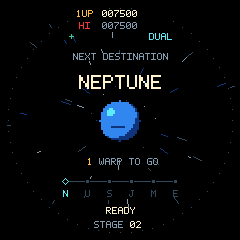

# Gyrus 2040

Playable native C11 orbital shooter for the Waveshare
**RP2040-Touch-LCD-1.28**, with a Sokol/Metal desktop simulator and headless runner.
The game uses original pixel art inspired by Gyruss: entering formations,
inward fire, diving enemies, meteors, satellite double fire, laser pairs,
six planetary destinations, chance stages, extra lives and game over.

**Autofire is ON by default at five volleys per second.** Touch START, steer, and tap the centre to pause.
Select LEFT / RIGHT, BORDER DRAG, or TILT on the title/pause screen.
Split touch is inverted: left turns clockwise, right counterclockwise. Tilt
calibrates after holding still for half a second at start/resume. The pause menu
has separate Quit and Reboot actions; Reboot needs a continuous five-second hold.
Open **Pause → Settings** to adjust fire rate (1–10 volleys/s), enemy speed
(25–200%), and tilt sensitivity (50–200%) with touch −/+ buttons. Values remain
selected across new games until reboot; defaults are 5/s, 100%, 100%.
Physical RESET always resets the chip immediately. BOOT can start/resume, and
can fire when autofire is disabled for debugging.



## Build and run

On macOS arm64 with Python 3, CMake, Ninja and Git:

```sh
python3 tools/setup.py
cmake --preset host
cmake --build --preset host
ctest --preset host
open build-host/gyrus_desktop.app
cmake --preset firmware
cmake --build --preset firmware
```

Setup installs pinned dependencies locally in `.deps/`, including the native
Arm toolchain, Pico SDK, picotool, pyserial and Sokol headers. No privileged
installer or system compiler replacement is used. The game core, renderer,
controls and protocol are C11; the macOS window/Metal bridge is Objective-C.
Other hosts can build the portable headless runner with
`-DGYRUS_BUILD_DESKTOP=OFF`; the bundled setup downloads macOS arm64 tools.

Firmware outputs are `build-rp2040/gyrus_game.uf2` and
`build-rp2040/gyrus_board_diag.uf2`, with ELF, linker map and disassembly.
The diagnostic remains available for display patterns, touch and SPI benchmarks.

Desktop: arrows/A,D turn; mouse emulates touch; Enter starts; Escape pauses;
M cycles steering modes. Tilt uses J/L to bank and 0/K to re-centre. Space
emulates BOOT. The debug server binds only 127.0.0.1:20400. To choose another port:

```sh
build-host/gyrus_desktop.app/Contents/MacOS/gyrus_desktop --debug-port 20401
```

## Device and debugging

The connected board can enter BOOTSEL through its USB reset interface:

```sh
.deps/picotool/picotool/picotool reboot -u --ser E463985803302D34 -f
```

Wait for BOOTSEL enumeration before loading. Alternatively, hold BOOT while
reconnecting USB. With one matching board connected:

```sh
.deps/picotool/picotool/picotool info --vid 0x2e8a --pid 0x0003
.deps/picotool/picotool/picotool load -v -x build-rp2040/gyrus_game.uf2 --vid 0x2e8a --pid 0x0003
```

The G1 protocol supports state, bounded field changes, logical input injection,
freeze/step, level selection, seed reset and CRC-checked framebuffer capture.
It runs over USB CDC, desktop loopback TCP or headless stdin/stdout:

```sh
.deps/venv/bin/python tools/gyrusctl.py --serial /dev/cu.usbmodem2241301 STATE
.deps/venv/bin/python tools/gyrusctl.py --serial /dev/cu.usbmodem2241301 -o capture.png FRAME
python3 tools/gyrusctl.py --tcp 20400 SET control_mode 2
python3 tools/gyrusctl.py --tcp 20400 LEVEL 6
python3 tools/gyrusctl.py --tcp 20400 PAUSE
python3 tools/gyrusctl.py --tcp 20400 STEP 120
```

For a repeatable device/native comparison, including fourteen screenshot captures:

```sh
.deps/venv/bin/python tools/smoke_game.py --serial /dev/cu.usbmodem2241301
```

Serial access has one owner. After an output deadline abort, close and reopen
the serial connection. The CLI clears stale input when connecting. `PAUSE`
freezes the debug scheduler; the game's on-screen pause is a separate menu.
A headless process exits with its state; use `--batch commands.txt` to keep a
scripted scenario in one process. See the [protocol reference](docs/debug-protocol.md).

## Hardware and performance

CPU/peripheral clocks 125 MHz, USB 48 MHz, SPI 62.5 MHz; no CPU overclock. Core0 runs
fixed 60 Hz simulation/input and indexed rendering. Core1 converts 16-row strips
while the previous RGB565 strip transfers by DMA. Two indexed frames and two
strips use 130,560 bytes. Circular transfer windows send 49,120 pixels instead of
57,600 after one complete GRAM initialization, reducing pixel traffic 14.7%.
The board measured roughly 14.4 ms per optimized presentation and about 60 frames/s
in short observations. Rendering and touch continue independently of DMA.
Presentation can be built at 30 Hz with `-DGYRUS_PRESENT_HZ=30`.

The final link reserves 8 KiB for core0's USB/debug stack in main SRAM and 4 KiB
for core1 in scratch SRAM; heap allocation is bounded below the core0 stack.
Pixel buffers and gameplay pools allocate no memory per frame. BOOT shares
flashCS, so its SRAM-only sampler uses coordinated multicore flash lockout.
The QMI8658A uses synchronized shadow-register reads for coherent 6-axis samples.
No TE wire is exposed; buffering cannot guarantee synchronized panel scanout.

- [Game implementation and validation](docs/hardware/2026-10-15-game.md)
- [On-device settings and verification](docs/hardware/2026-10-15-settings.md)
- [Controls and IMU details](docs/controls.md)
- [Gameplay/scoring](docs/gameplay.md)
- [Original assets and deterministic generator](docs/assets.md)
- [Earlier board diagnostic results](docs/hardware/2026-10-15-bringup.md)
- [Display design](docs/research/display-performance.md)
- [Game research](docs/research/game-reference.md)
- [Reference index](reference/README.md) and [download provenance](reference/manifest.json)
- [Third-party notices](THIRD_PARTY.md)

Downloaded references remain local and ignored, with upstream rights retained.
No arcade ROMs, extracted assets or audio are included. There is no onboard
speaker. The board's detected 16 MiB flash is linked conservatively as 4 MiB.
The original flash backup and development captures remain under ignored
`artifacts/`; the original backup was independently verified over its first 1 MiB,
which covers all firmware written in this session.
