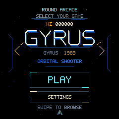
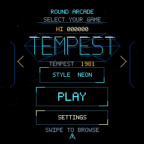
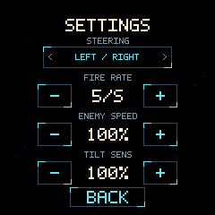
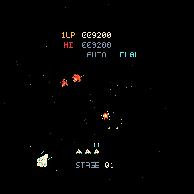
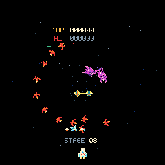
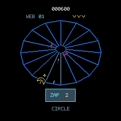
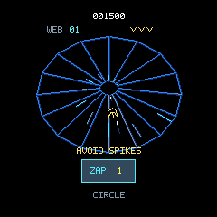
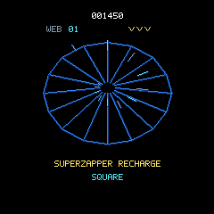

# Round Arcade · RP2040

A tiny arcade with two games in one firmware: **Gyrus**, an orbital space shooter
inspired by Gyruss, and **Tempest**, a vector tube shooter. Both run on a shared
native C11 engine, built for the
[Waveshare RP2040-Touch-LCD-1.28](https://www.waveshare.com/wiki/RP2040-Touch-LCD-1.28).
Play on its round touchscreen, or use the Sokol/Metal desktop simulator and
portable headless runner for development.

## Demo

https://github.com/user-attachments/assets/c9fabc5a-87a6-4457-b8e2-3b7ec1dce93b

*Menu + both games · 62 seconds · silent · 720 × 720 at 30 fps · 3.1 MiB.*
Recorded directly from the native renderer using the same C engine and assets
as the board. Normal autofire and scripted steering; both games clear their
first level without invincibility or level skipping. This is a software capture,
not camera footage of the LCD.

[Download the MP4](docs/media/round-arcade-demo.mp4) ·
[Capture instructions](docs/media/README.md)

| Time | In the demo |
| --- | --- |
| 00:00 | Scroll between graphical game titles, toggle Tempest's style, open Settings. |
| 00:09 | Gyrus: entrance formations, orbital combat, double fire, and a level warp. |
| 00:31 | Pause and return to the game menu. |
| 00:35 | Tempest: web entry, combat, Superzapper, dive, and the next web. |

<details>
<summary>Earlier Gyrus recording on the physical board</summary>

https://github.com/user-attachments/assets/ca1884a3-ee16-48ce-9918-4bd2ffbf2fec

The original [on-device demo](docs/media/gyrus-2040-demo.mp4) is also preserved:
35 seconds, silent, 4.0 MiB. It predates the multi-game launcher.

</details>

[Play](#play-on-the-board) · [Games](#games) · [Controls](#controls-and-settings) ·
[Build](#build-and-run) · [Flash](#flash-the-board) ·
[Debug](#debugging) · [Hardware](#hardware-and-performance) · [Documentation](#documentation)

## Play on the board

The **Round Arcade** menu opens at startup. A horizontal carousel holds a
graphical title card for each game, with its own animated backdrop and high score.

1. **Swipe left/right** or tap the gold arrows to browse **Gyrus** and **Tempest**.
2. Open **Settings** to choose steering and tune the selected game's difficulty.
3. Tap **PLAY** or press **BOOT** to start. **Autofire is already on**; just steer.
4. Tap the centre during play to pause. **Resume** continues the run;
   **Quit** returns to the game list so you can switch games.

On Tempest's card, tap **STYLE** to
choose classic vectors or optional Tempest 2000-inspired neon effects. Both
styles use the same classic rules.

| Gyrus card | Tempest card, neon selected |
| --- | --- |
|  |  |

Each game keeps its own high score, fire rate, enemy speed, and presentation
choice for the current session. Steering and tilt calibration are shared,
so switching games keeps the same comfortable control setup. Reboot restores
the defaults and clears these session scores.

## Controls and settings

### Steering

| Mode | How it works |
| --- | --- |
| **Left / Right** | Hold the left side to turn clockwise; hold the right side to turn counterclockwise. Release to stop. |
| **Border Drag** | Swipe around the rim to move the ship by the amount of your swipe. |
| **Tilt** | Lower the left or right edge like banking a tray. Hold still for half a second to calibrate in a comfortable pose. |

Settings shows tilt calibration progress and a live steering indicator. The
small ship arrow at the bottom of the game launcher also follows your tilt.
**Tap that arrow, then hold still, to set a new neutral position.** A fresh
calibration survives starting or resuming a game.

### Menus and buttons

| Action | Input |
| --- | --- |
| Browse / start a game | Swipe the launcher or tap its arrows, then **PLAY** / **BOOT**. |
| Pause | Tap the centre during play. |
| Change controls or difficulty | Open **Settings** from the title or pause menu. |
| Resume | Tap **Resume** or press **BOOT** in the pause menu. |
| Return from Settings | Tap **Back** or press **BOOT**. |
| Return to the game list | Choose **Quit** in the pause menu, or tap the back arrow on a game title. |
| Tempest Superzapper | Tap **ZAP** near the bottom of the web, or press **BOOT** once. |
| Reboot from the menu | Hold **Reboot** continuously for five seconds. |

The physical **RESET** button resets the chip immediately. During Gyrus, BOOT
can also fire manually when autofire is disabled through the debug interface.
During Tempest, BOOT triggers the Superzapper; shots fire automatically.

### Tune the game

Use the **− / +** buttons in Settings; no reflash is needed.

| Setting | Range | Default |
| --- | --- | --- |
| Fire rate | 1–10 volleys/s | 5 volleys/s |
| Enemy speed | 25–200%, in 25% steps | 100% |
| Tilt sensitivity | 50–200%, in 25% steps | 100% |

Selections survive quitting and starting new games. Reboot restores defaults.



## Games

### Gyrus

Orbit the screen's edge and fire inward at the enemy formations. Dodge diving
ships and their shots, collect double fire, and fight from Neptune toward Earth.
Enemies that fly away during combat return to attack: a wave ends when its
enemies have been destroyed, not when they leave the screen.

Gyrus includes destination-specific entrance formations, persistent attack/return
flights, inward fire, diving enemies, meteors,
satellite double fire, laser pairs, six planetary destinations, chance stages,
extra lives, and game over. Wave clears lead into an inward shrinking-ship warp;
planet arrivals precede chance stages, and bonus results appear before departure.

The art and timings are authored for this round display. The
[game research](docs/research/game-reference.md) and
[transition observations](docs/research/gyruss-transitions.md) and
[wave lifecycle study](docs/research/gyruss-waves.md) explain which
behaviors are supported by the original arcade references.

| Orbital combat | Saturn entrance formation |
| --- | --- |
|  |  |

### Tempest

Pilot the claw around the rim of a perspective web. Shoot Flippers, Tankers,
Spikers, Fuseballs, and Pulsars as they climb toward you. Open webs stop at their
ends; closed webs wrap around. Enemies that reach the rim can pursue and kill
the claw, so keep moving. Destroy enemies, clear a wave, then steer around
leftover spikes during the dive into the next web.

The first **Superzapper** use clears eligible enemies; the second destroys one.
It recharges on each level. The game uses bounded eight-shot pools, sixteen
independently authored web shapes, progressively introduced enemies, score-based
extra lives, and color cycles. Neon adds presentation effects without changing
rules, timing, or random sequences. Entry animations bring the claw onto each
web; clears lead through the spike dive into a tunnel flight. Shots, enemy
arrivals, hits, Pulsar attacks, and Superzapper use have visible action feedback.

This is a native reconstruction with authored geometry and timings. It includes
classic Tempest gameplay, not Tempest 2000's jump, AI droid, power-up chain, or
bonus modes. [Gameplay and differences](docs/tempest.md) ·
[1981 research](docs/research/tempest-arcade.md) ·
[Tempest 2000 research](docs/research/tempest-2000.md).

| Combat | Spike dive | Exit flight |
| --- | --- | --- |
|  |  |  |

The menu, Settings, and combat/dive screenshots above are fresh, lossless
240 × 240 frames from the native renderer. The Saturn entrance and Tempest exit
flight are framebuffer captures from the board. See [media details](docs/media/README.md).

## Shared engine

Both games share controls, calibration, menus, drawing primitives, font, debug
transport, and the optimized display pipeline. The frontends dispatch through a
small game registry; one active-state union keeps RAM usage low. Game rules and
renderers remain separate C modules. [Engine architecture](docs/engine.md) ·
[Graphics and launcher](docs/engine-graphics.md).

## Build and run

### Requirements

The bundled setup targets **macOS on Apple silicon**. Install **Python 3,
CMake, Ninja, and Git**, then run:

```sh
python3 tools/setup.py
```

Setup downloads pinned dependencies into `.deps/`: the Arm toolchain, Pico SDK,
picotool, pyserial, and Sokol headers. It uses no privileged installer and does
not replace the system compiler.

### Desktop simulator

```sh
cmake --preset host
cmake --build --preset host
ctest --preset host
open build-host/gyrus_desktop.app
```

| Input | Action |
| --- | --- |
| Arrow keys or A / D | Browse the launcher; turn during play. |
| Mouse | Emulate touchscreen input. |
| Enter / Escape | Start / pause. |
| M | Cycle steering modes. |
| J / L | Bank left / right in tilt mode. |
| 0 or K | Recenter tilt. |
| Space | Emulate BOOT: launch, Gyrus manual fire, Tempest Superzapper. |
| Z | Tempest Superzapper. |

The debug server listens on `127.0.0.1:20400`. To select another port:

```sh
build-host/gyrus_desktop.app/Contents/MacOS/gyrus_desktop --debug-port 20401
```

The core, renderer, controls, and protocol use C11; the macOS window/Metal bridge
uses Objective-C. Other hosts can build the portable headless runner with
`-DGYRUS_BUILD_DESKTOP=OFF`; the bundled dependency installer downloads macOS
arm64 tools.

### RP2040 firmware

```sh
cmake --preset firmware
cmake --build --preset firmware
```

| Output | Purpose |
| --- | --- |
| `build-rp2040/gyrus_game.uf2` | Shared launcher with both games. |
| `build-rp2040/gyrus_board_diag.uf2` | Display patterns, touch tests, and SPI benchmarks. |

The build also produces ELF files, linker maps, and disassembly.

## Flash the board

1. Unplug the board, hold **BOOT** while reconnecting USB, then release it.
2. Wait for the board to enumerate in **BOOTSEL** mode. With one matching board
   connected, verify it and load the game:

```sh
.deps/picotool/picotool/picotool info --vid 0x2e8a --pid 0x0003
.deps/picotool/picotool/picotool load -v -x build-rp2040/gyrus_game.uf2 --vid 0x2e8a --pid 0x0003
```

A running game can also enter BOOTSEL through USB. Replace `BOARD_SERIAL` with
your board's serial number:

```sh
.deps/picotool/picotool/picotool reboot -u --ser BOARD_SERIAL -f
```

## Debugging

The **G1 protocol** supports game selection (`GAMES`, `GAME gyrus`, `GAME tempest`,
`HOME`), state inspection, bounded field changes, logical
input injection, freeze/step, level selection, seed reset, and CRC-checked
framebuffer capture. It works over USB CDC, desktop loopback TCP, or headless
stdin/stdout.

### USB and desktop examples

Replace `/dev/cu.usbmodemXXXX` with your board's serial port.

```sh
# Read the connected board's state and capture its screen.
.deps/venv/bin/python tools/gyrusctl.py --serial /dev/cu.usbmodemXXXX STATE
.deps/venv/bin/python tools/gyrusctl.py --serial /dev/cu.usbmodemXXXX -o capture.png FRAME

# Select Tempest, tilt controls, and a stage in the desktop simulator.
python3 tools/gyrusctl.py --tcp 20400 GAME tempest
python3 tools/gyrusctl.py --tcp 20400 SET control_mode 2
python3 tools/gyrusctl.py --tcp 20400 LEVEL 6

# Freeze the debug scheduler and advance exactly 120 updates.
python3 tools/gyrusctl.py --tcp 20400 PAUSE
python3 tools/gyrusctl.py --tcp 20400 STEP 120
```

### Compare device and native output

This repeatable smoke test checks **72 scenarios**, comparing simulation state
hashes and every captured framebuffer pixel:

```sh
.deps/venv/bin/python tools/smoke_game.py --serial /dev/cu.usbmodemXXXX
```

To verify the launcher, game switching, classic/neon Tempest and both games:

```sh
.deps/venv/bin/python tools/smoke_arcade.py --serial /dev/cu.usbmodemXXXX
```

Serial access has one owner at a time. The CLI clears stale input when connecting;
after an output deadline abort, close and reopen the connection. Protocol
`PAUSE` freezes the debug scheduler; the game's on-screen pause is a separate menu.

For headless scenarios, use `--batch commands.txt` to keep all commands in one
process; a headless process exits with its state. See the
[complete protocol reference](docs/debug-protocol.md) for commands and examples.

## Hardware and performance

See the [official Waveshare hardware specifications and documentation](https://www.waveshare.com/wiki/RP2040-Touch-LCD-1.28)
for the board, pinout, schematics, and vendor resources.

| Component | Configuration |
| --- | --- |
| MCU | Dual-core RP2040; CPU/peripheral clocks at 125 MHz, without CPU overclocking. |
| Memory | 264 KiB SRAM; firmware linked for 4 MiB flash. The tested board reports 16 MiB physical flash. |
| Display | 1.28-inch round touchscreen, 240 × 240 pixels, RGB565 color. |
| Display link | SPI at 62.5 MHz; USB clock at 48 MHz. |
| Motion | QMI8658A accelerometer and gyroscope with synchronized six-axis reads. |
| Simulation | Fixed 60 Hz input and gameplay on core 0. |
| Presentation | About 60 frames/s in observed runs; roughly 14.4 ms per optimized transfer. |
| Pixel buffers | Two indexed frames and two RGB565 strips: 130,560 bytes total. |

Core 0 renders indexed frames while core 1 converts 16-row strips and sends
them over SPI DMA. After one full display initialization, circular transfer
windows send **49,120 rather than 57,600 pixels**, reducing pixel traffic by
14.7%. Rendering and touch processing continue independently of DMA. To build
for 30 Hz presentation, set `-DGYRUS_PRESENT_HZ=30`.

Gameplay pools and pixel buffers allocate no memory per frame. The linker
reserves 8 KiB for core 0's USB/debug stack in main SRAM and 4 KiB for core 1 in
scratch SRAM, with the heap bounded below core 0's stack. Because BOOT shares
flash CS, its SRAM-only sampler uses coordinated multicore flash lockout.
No TE wire is exposed, so buffering cannot guarantee synchronized panel scanout.

## Documentation

| Topic | Read more |
| --- | --- |
| Controls, calibration, and IMU | [Controls guide](docs/controls.md) |
| Gameplay and scoring | [Gyrus](docs/gameplay.md) · [Tempest](docs/tempest.md) |
| Shared engine and new games | [Architecture](docs/engine.md) · [Graphics](docs/engine-graphics.md) |
| Debug commands and automation | [G1 protocol](docs/debug-protocol.md) |
| Pixel art and deterministic generation | [Assets](docs/assets.md) |
| Display architecture and bottlenecks | [Display performance](docs/research/display-performance.md) |
| Original game and transition references | [Game research](docs/research/game-reference.md) · [Transitions](docs/research/gyruss-transitions.md) |
| Source material and provenance | [Reference index](reference/README.md) · [Download manifest](reference/manifest.json) |
| Third-party components | [Notices](THIRD_PARTY.md) |
| Demo encoding and playback | [Video details](docs/media/README.md) |

<details>
<summary>Hardware validation reports</summary>

- [Gyrus wave and Tempest corrections](docs/hardware/2026-10-16-wave-and-tempest-corrections.md)
- [Shared engine and Tempest verification](docs/hardware/2026-10-16-multigame-tempest.md)
- [Physical tilt axes and tap-to-recenter](docs/hardware/2026-10-15-tilt-recenter.md)
- [Settings, 3D tilt, and transition verification](docs/hardware/2026-10-15-controls-transitions.md)
- [On-device settings verification](docs/hardware/2026-10-15-settings.md)
- [Game implementation and validation](docs/hardware/2026-10-15-game.md)
- [Board bring-up and diagnostic results](docs/hardware/2026-10-15-bringup.md)

</details>

## Scope and local files

This project uses original pixel art inspired by Gyruss and authored vector
geometry inspired by Tempest. No arcade ROMs,
extracted game assets, or original game audio are included. The board has no
onboard speaker, and the demonstration video has no audio track.

Downloaded references stay local and ignored; their upstream rights are retained.
Builds, dependencies, flash backups, and development captures also stay local
under the ignored `build-*`, `.deps/`, and `artifacts/` directories. The original
flash backup was independently verified over its first 1 MiB, covering the
firmware written during bring-up.
