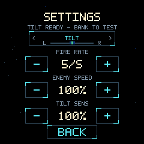
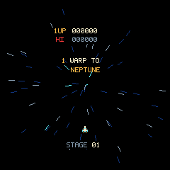
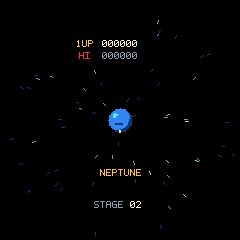

# Settings, 3D tilt, and arcade transitions

The canonical project is `/Users/alex/Documents/Projects/iob.dev/repos/gyrus-2040`.
This update is built and flashed on the connected Waveshare board. Picotool
verified all written flash bytes before reboot. Machine-readable measurements
are in [the results file](2026-10-15-controls-transitions-results.json).

## Input fixes

Settings now replaces the former control selector on the title and game-over
screens. Pause also offers Settings. The steering selector is inside Settings,
above fire rate, enemy speed, and tilt sensitivity. Back (or BOOT) returns to
the menu that opened it; starting a game preserves the selected values.

The former tilt controller required a substantial gravity projection onto X/Z.
A board held upright with gravity along Y could never calibrate. A literal
upright sensor fixture reproduced the failure before the fix. Calibration now
learns the complete gravity vector and all three gyro biases. A projected
screen-right direction and its perpendicular gyro axis support flat, upright,
and inclined neutral poses. Sensor filtering, deadzone, speed limits, and stale
sample protection remain bounded integer operations.

Settings displays calibration progress, then a signed steering preview. Fresh
calibration survives menu/start/resume transitions, and fresh IMU samples are
processed while in menus. Hold still for half a second after selecting TILT;
then bank to test the indicator. No level/flat pose is required. Mode changes,
stale/invalid data, and unusable bank projections require fresh calibration.

## Travel and results

The [research notes](../research/gyruss-transitions.md) distinguish direct
arcade observations from authored timing and graphics. Normal combat clear
holds the quiet field for 0.5 seconds, then shrinks the ship inward during a
1.5-second warp with accelerating radial stars. The final warp approaches a
centered planet for two seconds, then enters the chance-stage introduction.
Chance completion holds a readable bonus result for two seconds, then departs
through another warp. Perfect results show the 10,000-point award without an
incorrect `100 X 40` equation. The existing planet route remains unchanged.

Transitions freeze player combat, preserve lives/double fire, clear remaining
hazards, award the result once, and advance once. Pause preserves the animation
position. The ship returns to the bottom for the next introduction. The
original inward journey, planet-before-chance order, and bonus multiplier
presentation informed the implementation; this is not a ROM-exact timing port.

## Verification

- All 21 host suites pass with address/undefined-behavior sanitizers. New tests
  cover title/game-over Settings gating, full 3D neutral/bias/gyro projection,
  calibration preservation, live preview, single bonus/advance, transition
  timing, and pause behavior. Renderer tests check all nine phases, early/mid/
  late animation frames, purity, palette, circular clipping and buffer guards.
- An independent review passed 13 targeted core/input suites and the renderer
  suite. ARM stack inspection reports a 192-byte `game_render` frame and a
  largest helper frame of 136 bytes; no heap allocations or large scratch
  images were added.
- `tools/smoke_game.py` compares 36 connected-device scenarios against the
  native executable. All state hashes and every framebuffer pixel match,
  including title Settings, normal warps, Neptune/Earth arrivals, chance result
  and departure. Explicit phase assertions prevent matching two wrong paths.
- Real IMU readings after flashing reported successful stationary calibration
  in all 415 samples over a 90-second stationary check. Presentation averaged
  60 fps, with no additional dropped frames, simulation overruns, touch errors
  or display errors during that check. No physical movement or touch was observed
  during this window. User movement/menu acceptance is recorded
  separately in the results file; deterministic replay is not a substitute for
  physically banking the board or touching its LCD.
- CPU/peripheral clocks remain 125 MHz and display SPI 62.5 MHz. ELF text is
  138,824 bytes and BSS 141,648 bytes. Raw captures, flash verification output,
  and interaction telemetry are under `artifacts/controls-transitions/`.

STATE now includes phase ticks, tilt progress/preview and raw hardware touch
state, target/interlocks, accelerometer and gyro samples for further diagnosis.
No tuning values are written to flash; reboot restores defaults.
