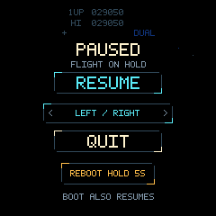

# Native game integration — 15 October 2026

The connected RP2040 board now runs the C11 game. The final UF2 was loaded and
fully verified by picotool. The desktop uses the same core, input math, renderer
and original assets. No CPU overclock was used.

## Delivered behavior

Autofire defaults ON. Touch can start, steer, pause, resume and quit without
holding a button. Selectable steering modes are split left/right hold, relative
border drag, and calibrated tilt. Tilt uses coherent QMI8658A accelerometer/gyro
samples, a complementary filter, a three-degree dead zone and proportional
orbit speed. A neutral pose is learned after 500 ms of stillness at start/resume.
Stale or implausible motion stops steering and requests calibration again.

Physical RUN cannot be intercepted; the pause menu implements separate Quit and
Reboot actions, with a continuous five-second hold required for Reboot. BOOT
remains a start/resume/manual-fire input, sampled safely from SRAM using
multicore flash lockout. Review confirmed its linked callback and literals are
at 0x200000c0, with no calls into flash while QSPI_CS is released.

The game includes entering/dive/return formations, inward fire, hostile shots,
satellite double fire, indestructible meteors, paired laser beams, scoring,
extra lives, deaths/invulnerability, game over, six destinations, chance stages
and increasing difficulty after a route. Trajectories and graphics are authored
for this adaptation; this is not an arcade-ROM emulator. Audio and IMU-based
absolute pointing are outside this implementation.

## Verification

- 19/19 CTest suites passed with address/undefined sanitizers; Python tests 8/8.
- Renderer tests exercise 32 seeds across all 7 phases, all entity roles, three
 control modes, calibration/progress states, palette bounds, circular aperture,
 canaries, determinism and state purity.
- Driver fake-I2C tests cover register readbacks, the corrected gyro full-scale
 setting, synchronized locking, updates during a locked read, status/burst read
 failures, stale-lock cleanup, timeout, signed scaling and fallback address.
- Asset regeneration recreated 24 files byte for byte.
- G1 device/native replay matched simulation hashes and exact pixels for 8 cases:
 title, intro, combat, chance, lasers, Earth, next route and menu. Each binary
 capture includes lengths and CRC32. Captures were viewed during integration.
- Independent review found and drove fixes for touch error quarantine, absolute
 USB/socket output deadlines, stale RX after DTR reconnect, motion timestamp
 ordering and coherent IMU reads. The final targeted review found no remaining
 actionable issues in these paths.

The user confirmed clean display, turning, physical BOOT firing, pause, mode
selection, Resume, Quit and default autofire. Physical tilt-direction feedback
is pending; the five-second on-screen reboot was not physically tested. Its
input state machine is covered by host tests. These distinctions matter:
framebuffer capture does not independently prove panel scanout quality.




## Display pipeline and memory

CPU/peripheral/USB 125/125/48 MHz; SPI1 at 62.5 MHz. The GC9A01 uses GPIO13 reset,
GPIO8 DC and GPIO9 CS. Core0 simulates at 60 Hz and renders indexed8; core1
converts the next 16-row band while the previous RGB565 strip transfers by DMA.
Queue ownership keeps submitted frames immutable until presentation completes.
FRAME waits for pending presentations and reserves a free buffer synchronously.

After the first complete 240×240 GRAM initialization, circular band windows cover
all visible pixels plus a two-pixel aperture margin. Pixel transfers decrease
from 57,600 to 49,120 per frame (14.7%). Window/copy tests check every pixel inside
that margin, invalid bands, destination capacity and guard words.

The final 10.324-second idle observation measured about 60.05 presentations/s,
zero dropped frames, zero new scheduler overruns, zero SPI errors and zero
new touch read/decode failures. Last presentation 14.379 ms; render 7.367 ms.
The max 17.174 ms presentation includes initial full-screen work. Earlier live
interaction measured 59.92 presentations/s over 15.5 s. These are short observations,
not battery endurance or universal worst-case guarantees. Debug STEP/capture
can deliberately suspend realtime simulation and increase historical overrun
counters. 30 Hz remains a build option.

Frame/strip storage is 130,560 bytes. The ELF reports 128,992 text bytes and 141,544 BSS
bytes. The linked main stack is 8 KiB at 0x2003e000..0x20040000; core1 has 4 KiB in
scratch X at 0x20040000..0x20041000. Heap limits stop below the main stack, with
110,616 bytes between static main-SRAM allocation and that limit before small
startup queue allocations. Assets occupy about 34 KiB flash and no mutable RAM.
The linker conservatively budgets 4 MiB of the detected 16 MiB board flash.

No TE pin is exposed, so transfer buffering cannot guarantee panel scanout
synchronization. A transfer fault disables further strip presentation and keeps
USB diagnostics available; firmware does not reuse a possibly active DMA strip.

## Reproduce

Build/run commands are in the [README](../../README.md). With the final firmware
running and one serial owner:

```sh
.deps/venv/bin/python tools/smoke_game.py --serial /dev/cu.usbmodem2241301
.deps/venv/bin/python tools/gyrusctl.py --serial /dev/cu.usbmodem2241301 STATE
```

STATE includes clocks, frame timing/counters, display status, touch failures,
BOOT-sampler failures, mode, IMU revision, raw scaled motion and sample age.
The physical sensor reports revision 0x7c. It is configured for ±4g/±512°/s,
ODR code 6 (about 112 Hz in QMI8658A 6DOF mode), filtered synchronized sampling.
The documented AHB-clock-gating/CTRL9 handshake precedes SyncSample enablement;
each read locks shadow registers and releases them through GZ_H.

The [machine-readable report](2026-10-15-game-results.json) records final firmware
SHA256, replay hashes/CRCs, memory and measured counters. Raw captures, timing
samples, earlier probe firmware, desktop screenshots and socket slow-reader
measurements are retained under ignored `artifacts/game/`.
