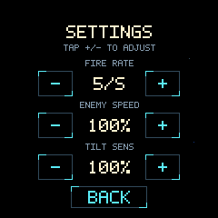

# Settings on the device — 15 October 2026

Pause with a centre tap, then select **Settings**. Tap −/+ beside a value, use
**Back**, then **Resume**. BOOT can also resume directly from Settings. Editing
keeps gameplay paused. Values stay selected across quit/retry/newgame until a
reboot; they are held in RAM and need no firmware rebuild or flash write.

| Setting | Range | Step | Default |
| --- | --- | --- | --- |
| Fire rate | 1–10 volleys/second | 1 | 5/s |
| Enemy speed | 25–200% | 25% | 100% |
| Tilt sensitivity | 50–200% | 25% | 100% |

Fire rate uses a fractional tick remainder, so values such as 7/s retain the
correct average at 60 Hz. Double fire still emits paired shots per volley. Enemy
speed controls a separate clock for formations, spawn intervals, attack phases,
hazards, lifetimes and hostile shots. Player steering and projectiles retain
their normal 60 Hz clock. Collision checks run on player ticks even when slow
enemies have no movement step, and on both substeps at 200% speed.

Tilt sensitivity scales the steering gain after the existing three-degree dead
zone and before the maximum turn-speed cap. Calibration, filtering and stale
sensor handling remain active. 100% preserves the preceding tuned response.

The pause menu and settings controls share exact rectangles with hit testing.
Each valid short release changes a value once; holds, drags, stale contacts and
touch-read failures cannot repeat or accidentally activate another menu target.
Buttons dim at their corresponding limits. The values also appear in G1 STATE;
allowlisted SET fields and menu input pulses support automated verification.

Verification completed:

- 20/20 CTest suites passed with address/undefined sanitizers, including an
 independent clean review build.
- Core tests cover defaults/ranges, preservation, exact fire cadence for all 10
 rates across 600 ticks, paused adjustments, live enemy speed changes and
 collisions during idle enemy ticks.
- Controls tests cover each new button's boundaries, release pulses, held-touch
 suppression, cancellation, BOOT resume and tilt gains at 50/100/200%.
- Renderer tests exercise all setting values, limits, visible button borders,
 circular bounds, state purity and deterministic captures.
- Firmware loaded and fully verified by picotool on board E463985803302D34.
- Fourteen device/native cases matched both simulation hashes and exact pixels,
 including default/adjusted/minimum/maximum Settings, Back and resume.

The review fixed two scaled-clock issues before flashing: encounter timing now
slows together, preventing overlapping unintended laser-pair chains; hostile
bullet collisions remain checked during player movement on idle enemy ticks.
The settings page and fractional clock state are included in the state hash.

The [machine-readable report](2026-10-15-settings-results.json) includes the
firmware SHA256, memory footprint and replay/capture results. Raw evidence is
kept under ignored `artifacts/settings/`. Physical touch acceptance is requested
separately; the host input tests and rendered captures are not a camera-based
or robotic touch test.
