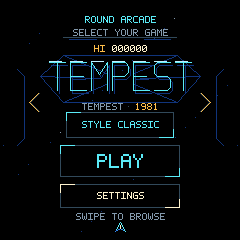
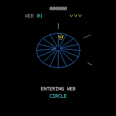

# Shared engine and Tempest verification · 16 October 2026

The shared launcher, Gyrus and Tempest firmware was flashed with picotool and
fully verified on the connected RP2040-Touch-LCD-1.28. This report records the
refactor/Tempest baseline before the subsequent Gyruss wave-fidelity correction.

## Delivered and checked

- Immutable game registry, one active-state union, shared input/calibration,
  Settings, drawing/font/math and G1 transport; independent scores/difficulty.
- Horizontal graphical-title launcher with swipe/arrows, Play and Settings.
- Classic Tempest rules, 16 authored webs, five enemy families, two Zapper uses,
  persistent spikes, dangerous dive, optional cosmetic neon style.
- Animated web entry, clear flash, dive/exit/next-web flight; bounded shot, hit,
  arrival, split, Pulsar, death and Superzapper feedback.
- Per-queued-frame immutable palette ownership. Existing DMA/BOOT/USB safety,
  sensor axes and hardware clocks remain intact.

All 28 host CTest groups passed with ASan/UBSan. The independent review drove
fixes for paused-death recovery, final-row pointer construction, late-level
preview wrapping, and adjacent injected Zapper pulses. Held physical BOOT remains
debounced by the shared controls. Player rendering follows HUD/messages and has
a dark outline.

Gyrus matched the saved pre-refactor executable across 39 state/JSON replay
cases; 36 standalone renderer frames also matched byte for byte. This proves
refactor compatibility with the previous adaptation, not arcade fidelity.
The user's subsequent report about original Gyruss waves requires deliberate
changes to those old gameplay assumptions.

Final USB/native comparisons passed 45 launcher/Tempest scenarios and all 36
Gyrus scenarios, with exact PNG/pixel equality and matching simulation hashes.
The Tempest cases assert actual entry/clear/dive/flight/next-entry phases in
addition to image equality. Captures include classic/neon gameplay and Zapper
feedback. No download artwork or ROM data is used by runtime assets.

## Timing and memory

Clocks: CPU/peripheral 125 MHz, USB 48 MHz, display SPI 62.5 MHz. A 45-scene
frozen-state timing sweep excluded debug setup from each measured interval:

| Scenes | Sampled render time | Presentation time |
| --- | --- | --- |
| Launcher and Settings | 2.98–3.82 ms | 14.29–14.48 ms |
| Gyrus combat | 2.74 ms | 14.35 ms |
| Tempest classic: 16 webs and four transition phases | 1.49–2.20 ms | 14.30–14.49 ms |
| Tempest neon: same coverage | 1.77–3.06 ms | 14.32–14.50 ms |

Observed presentation remained approximately 60 Hz, with zero new drops,
simulation overruns, display errors or touch errors in those dwell intervals.
The cumulative maximum input/simulation sample was 1.158 ms. These are sampled
scenes, not a universal worst-case or panel scanout guarantee. Debug STEP and
FRAME intentionally suspend realtime scheduling and can increase historical
counters outside the measured intervals.

The shared circle mask now uses an exact 240-byte ROM span table, and fills clip
once before row writes. Independent per-pixel geometry tests protect the old
boundary pixels. Before optimization the sampled Settings render was 10.94 ms;
post-optimization launcher/Settings samples remain below 3.83 ms.

The ELF reports 157,660 text bytes, zero initialized data and 141,720 BSS bytes.
Static RAM grew by 72 bytes over the previous single-game build: Tempest and its
visual pool fit inside the larger existing game-state union. Pixel/strip buffers
still occupy 130,560 bytes. The linker reserves 8 KiB core0 stack and 4 KiB core1
stack, with heap ending below core0's stack. GCC stack-usage output's largest
application frame is the bounded protocol parser at 1,960 bytes; this is static
frame accounting, not a measured stack high-water mark.

## Reproduce and inspect

```sh
cmake --build --preset host
ctest --preset host
cmake --build --preset firmware
.deps/venv/bin/python tools/smoke_arcade.py --serial /dev/cu.usbmodemXXXX
.deps/venv/bin/python tools/smoke_game.py --serial /dev/cu.usbmodemXXXX
.deps/venv/bin/python tools/profile_arcade.py --serial /dev/cu.usbmodemXXXX
```

Local detailed evidence is under ignored `artifacts/multigame/`: the
`final-device-smoke/`, `final-gyrus-device-smoke/`, `performance-final.json`,
`gyrus-compat.json` and graphics extraction corpus. The final baseline UF2 has
SHA-256 `3a1af75832cdc63e544e6820da1e6216e9b403cb3aa79356699ecd060a2a7bf8`.





Framebuffer captures and transport checks do not independently prove panel
scanout quality or physical touch/tilt feel. Existing board controls were
previously user-validated; final launcher/Tempest physical acceptance remains
available for user feedback.
