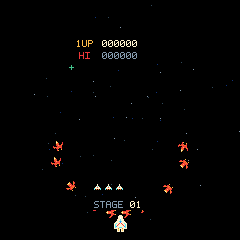

# Gyrus waves and Tempest corrections · 16 October 2026

These changes follow the user's play feedback after the shared-engine baseline
[05e4787 report](2026-10-16-multigame-tempest.md). Research stopped at the user's
request; implementation uses the findings already collected.

## Gyrus

The previous adaptation expired every ordinary enemy after age 780, then cleared
combat once no ordinary enemies remained. It could win with zero kills. Paths,
holding radii and attack clocks also depended on reusable entity-array slots.

The corrected lifecycle retains offscreen returning fighters, uses stable
formation/member identities and requires complete destroyed/escaped accounting.
Four entrance groups assemble before coordinated attacks; Mars has the documented
individual peeling exception. Six authored path families represent the different
destination roles. Only the final two fighters may make a terminal escape, after
an attack/return opportunity. Shooting either fleeing fighter awards 1,000.

Whole entrance-group kills award escalating bonuses. One depleted-formation
reinforcement uses one fixed random entrance choice and schedules its train
relative to activation. The exact original fifth-group threshold and later path
coordinates remain uncertain: this build labels its greater-than-30 entry-kill
trigger and control points as inferred/authored. See [evidence](../research/gyruss-waves.md)
and [gameplay](../gameplay.md) for the distinction.

New regressions exercise 100,000 no-fire updates with 40 persistent survivors,
offscreen return, stable paths through pool reuse, assembly gating, Mars peeling,
last-two escapes/scoring, missing-entity accounting, chance-stage departures,
fifth-wave choice/spacing, formation bonuses and debug completion. A natural
Saturn replay kills 31 entrants and retains nine, ensuring late reinforcements
keep their paired/single-file spacing instead of collapsing into consecutive ticks.

## Tempest

FLIGHT previously grew the next web, then INTRO reset and grew it again. FLIGHT
now recedes only the outgoing web; the next web grows once during INTRO. The
entry/clear/dive/flight timing remains unchanged.

Rim Flippers/Pulsars pursue the claw using open/closed topology. Upright flips
remain shootable; a final pounce already on the claw resolves before a new muzzle
shot can erase it. Fuseballs seek and contact the bordering rails. Pulse damage
and highlighted rails stay in the same source lane until a crossing completes.
No inactivity timer or altered rim-only completion rule is used.

Across 64 seeded first-wave Circle replays, stationary default autofire now loses
a life in 61 cases, compared with 11 before the fix. This measures natural attack
pressure, not guaranteed failure for every stationary run. A targeted steering
dodge survives the same pounce; an empty web cannot kill an idle player. All
visual events remain bounded and excluded from canonical gameplay hashes.

## Final verification

- All **29 CTest groups** passed with ASan/UBSan; native desktop and RP2040 builds
  succeeded with strict game-library warnings.
- Picotool loaded and fully verified the final UF2 on the connected board.
- **72 Gyrus** native/device cases matched state hashes and every screenshot,
  including four entrance groups and long no-fire persistence at all six
  destinations. Transition captures explicitly use the debug completion command,
  rather than relying on the removed automatic-expiry behavior.
- **45 launcher/Tempest** cases matched, including classic/neon, Zapper,
  entry/clear/dive/flight/next-entry, pause/Settings and game switching.
- Independent review reproduced and drove fixes for delayed fifth-wave cadence
  and crossing-Pulsar pulse alignment. Focused rechecks passed afterward.

A final 45-scene frozen-state timing sweep, excluding debug setup, recorded:

| Scene family | Sampled render time | Presentation time |
| --- | --- | --- |
| Launcher/Settings | 3.10–3.68 ms | 14.29–14.40 ms |
| Gyrus combat | 3.45 ms | 14.32 ms |
| Tempest classic | 1.57–2.53 ms | 14.29–14.47 ms |
| Tempest neon | 1.86–3.49 ms | 14.30–14.45 ms |

Presentation was approximately 60 Hz, with no new dropped frames, simulation
overruns, display errors or touch errors during those measured dwells. The
cumulative input/simulation maximum was 1.377 ms. Historical counters include
synchronous debug STEP/capture pauses; they are not realtime frame-loss rates.
These sampled timings are not a universal worst-case or panel scanout guarantee.

The ELF has 161,188 text bytes, zero initialized data and 141,928 BSS bytes. Pixel
buffers remain 130,560 bytes, with the original 8 KiB/4 KiB stack reservations and
125/125/48 MHz CPU/peripheral/USB clocks, 62.5 MHz SPI. The final UF2 SHA-256 is
`854b45890c2a5cff2b403c8d1f6f72df7fb5afa7b4baf526905b817834521114`.
Detailed local reports live under ignored `artifacts/multigame/`:
`corrections-device-smoke`, `corrections-gyrus-device-smoke`,
`performance-corrections.json`. The board is left at the running Gyrus launcher,
with test invincibility removed and defaults restored for both games.
