# Display, CPU, memory and interaction performance

Research date: 15 October 2026. **Design analysis, not measured hardware results.**
The device is not connected. Proposed optimizations require firmware and bench
validation before any frame-rate or latency claim.

## 1. Circuit and real interfaces

Source: [Waveshare schematic, sheet 1](../../reference/hardware/board-schematic.pdf),
checked against the vendor C `DEV_Config.h` in the downloaded archive.

| Function | RP2040 GPIO | Interface / note |
| --- | --- | --- |
| LCD clock | 10 | SPI1 SCK |
| LCD pixels/commands in | 11 | SPI1 TX -> panel SDA |
| LCD data out | 12 | Panel SDO -> SPI1 RX; not needed for normal writes |
| LCD command/data | 8 | GPIO; low command, high data |
| LCD chip select | 9 | Software-controlled GPIO, active low |
| LCD reset | **13** | Active low |
| LCD backlight | 25 | PWM drives Q1 gate; backlight supply is separate from pixel transport |
| Touch and IMU SDA | 6 | I2C1 |
| Touch and IMU SCL | 7 | I2C1 |
| Touch interrupt | 21 | Interrupt flag, defer I2C work |
| Touch reset | 22 | Separate from LCD reset |
| IMU interrupts | 23, 24 | Optional data-ready signaling |
| Supply ADC | 29 / ADC3 | Schematic divider is 200 kOhm + 100 kOhm from VSYS |

**SDK discrepancy:** at the pinned SDK revision, `WAVESHARE_LCD_RST_PIN` is
defined as 12 in `waveshare_rp2040_touch_lcd_1.28.h`. The schematic and vendor
driver both say 13. Explicitly define the project board map and override that
macro before the SDK board header is read. Do not use `spi_default`: the board
header defaults general-purpose SPI to SPI0; the LCD uses SPI1.

The LCD connector exposes SPI and control pins, not RGB/DOTCLK or an 8080
parallel bus. It exposes no TE pin. PIO cannot create missing PCB connections.
The backlight PWM has no effect on pixel transfer speed.

The supply ADC is labeled BAT_ADC, but the shown divider measures **VSYS**, not
directly the cell terminal. Under USB power it is not a battery state-of-charge
measurement. There is no speaker/amplifier shown on the schematic.

Revision discrepancies to retain: the schematic labels the IMU QMI8658C while
the wiki supplies a QMI8658A datasheet; the schematic flash label is W25Q128,
while the product and SDK board definition specify 4 MiB. Identify the actual
parts on connection. Budget only 4 MiB flash in the meantime.

## 2. The display owns its scanout memory

The supplied [GC9A01 datasheet](../../reference/hardware/GC9A01A.pdf), pp.5-6,
describes 129,600 bytes of controller GRAM for 240 x 240 x 18-bit color. That
memory is internal to the LCD controller. It is **not CPU-addressable RP2040
RAM**, and the MCU cannot render into it through ordinary loads/stores.

Configure 16-bit RGB565 input using COLMOD (0x3A), following the panel vendor's
initialization values. One host frame is 240 x 240 x 2 = **115,200 bytes**.
The controller scans GRAM autonomously; SPI is only needed to change its contents.

Keep these rates separate:

- **Simulation rate:** how often gameplay advances.
- **Render rate:** how often the CPU constructs a picture.
- **Transfer rate:** how often changed pixels reach controller GRAM.
- **Panel scan rate:** the panel's independent LCD refresh.

More SPI transfers per second do not establish a higher panel scan rate.
Two MCU framebuffers prevent the DMA source from changing mid-transfer; they
do not provide a GRAM page flip or synchronized panel double buffering.

The preliminary datasheet has inconsistencies: its GRAM chapter later mentions
320 x 240, and the command labeled "Frame Rate (E8h)" describes inversion mode.
Use the confirmed 240 x 240 addressable region and vendor initialization. Do
not infer a working refresh-rate control from that heading.

## 3. Clock domains and SPI quantization

The [RP2040 datasheet](../../reference/hardware/rp2040-datasheet.pdf), sections
2.15 and 4.4, describes `clk_sys`, `clk_peri`, and the SPI divider:

```text
SPI_SCK = clk_peri / (CPSDVSR * (SCR + 1))
CPSDVSR = an even integer from 2 through 254
SCR     = an integer from 0 through 255
```

The pinned SDK implementation chooses a realizable speed no higher than the
request. Record both `clock_get_hz(clk_sys)`, `clock_get_hz(clk_peri)` and the
return value of `spi_init`/`spi_set_baudrate`.

| CPU and peripheral clock | Requested SCK | Actual SCK | Consequence |
| --- | --- | --- | --- |
| 125 MHz | 20 MHz | 15.625 MHz | Conservative initial transfer profile |
| 125 MHz | 40 MHz | **31.25 MHz** | Vendor basic demo request is not achieved exactly |
| 125 MHz | 62.5 MHz | **62.5 MHz** | Recommended fast profile to qualify |
| 133 MHz | 40 MHz | **33.25 MHz** | Small gain over 125 MHz, still insufficient for full 60 Hz frames |
| 133 MHz | 62.5 MHz | **33.25 MHz** | Faster CPU can halve SPI throughput if the request is unchanged |
| 133 MHz | 66.5 MHz | **66.5 MHz** | Divider result; needs explicit qualification, see below |

The RP2040 text calls the master maximum 62.5 Mbit/s even while discussing a
133 MHz input whose divide-by-two result is 66.5 MHz. Preserve this ambiguity:
use **125/62.5 MHz** as the fast baseline and label **133/66.5 MHz** experimental.
Do not treat the arithmetic alone as a guaranteed electrical specification.

The supplied controller's four-wire SPI table (p.190, table 48) lists a 10 ns
minimum write clock period and 5 ns high/low widths at its stated conditions.
These are controller timings, not a guarantee for the assembled module at
100 MHz. Read transactions have a much longer 150 ns minimum clock period;
switch to a suitably slower profile when probing MISO.

Start with the SDK's ordinary supply settings and a 125 MHz system clock.
Raising the system clock does not automatically mean the peripheral clock
changes as intended: configure and log both. Keep USB at 48 MHz; do not derive
USB timing from an experimental system clock.

The current RP2040 datasheet also describes 200 MHz operation with elevated
DVDD at 1.15 V. That does not qualify this board, flash or display path at that
rate. The vendor LVGL archive uses a 270 MHz system/peripheral clock and asks
`spi_init` for 270 MHz; the latter actually divides to at most **135 MHz**.
That configuration exceeds the controller write timing table as well as the
board's advertised CPU rate. It is not the project's baseline.

## 4. Wire limits: the first bottleneck

These are ideal **payload-only** bounds with no FIFO gaps, commands, conversion
work or scheduling delay:

```text
frame_bits       = width * height * 16
transfer_seconds = frame_bits / actual_SCK
payload_fps      = actual_SCK / frame_bits
60 Hz full frame requires 55.296 Mbit/s of pixel payload.
```

| Actual SCK | Full frame minimum | Payload-only maximum |
| --- | --- | --- |
| 15.625 MHz | 58.982 ms | 16.95 frames/s |
| 31.25 MHz | 29.491 ms | 33.91 frames/s |
| 33.25 MHz | 27.717 ms | 36.08 frames/s |
| 62.5 MHz | 14.746 ms | 67.82 frames/s |
| 66.5 MHz, experimental | 13.859 ms | 72.16 frames/s |

At 62.5 MHz, a 16.667 ms presentation interval has only **1.921 ms** beyond ideal
wire time. DMA is essential for overlap but does not shorten wire time. The
PL022's mode-0 inter-word behavior and any FIFO starvation add overhead; the
table is not a prediction of measured 60 fps.

The CPU is not the only clock to optimize. Main SRAM runs on the system bus,
external QSPI flash/XIP has a separate divider and cache behavior, and LCD GRAM
scanout is independent. There is no configurable RP2040 "VRAM clock" for this panel.

## 5. Memory layout and CPU overlap

264 KiB SRAM = **270,336 bytes**. Two RGB565 frames take 230,400 bytes, leaving
only 39,936 bytes for everything else. That is an uncomfortable budget for
game state, two cores, stacks, USB, hot code and staging.

Recommended palette pipeline:

| Static allocation | Budget |
| --- | --- |
| Two 240 x 240 8-bit indexed frames | 115,200 B |
| Two 240 x 16 RGB565 conversion strips | 15,360 B |
| 256-entry RGB565 palette | 512 B |
| Rectangle lists, dirty flags, queue descriptors | 4,096 B |
| Gameplay/entity pools | 24,576 B |
| Hot code, lookup tables and sprite cache | 32,768 B |
| Combined core stacks | 8,192 B |
| SDK/USB/runtime globals allowance | 16,384 B |
| **Total planned use** | **217,088 B = 212 KiB** |
| **Unallocated headroom** | **53,248 B = 52 KiB** |

These are budgets, not linked sizes. Verify the map file and stack high-water
marks. The first three entries together are exactly **128 KiB**.

Use one fixed palette for the initial game; changing it requires re-uploading
affected pixels because LCD GRAM stores expanded color, not palette indices.
8-bit rendering saves MCU memory but **does not halve SPI traffic**: the LCD
still receives 16 bits for every changed pixel. Avoid RGB666's 24-bit wire cost.

```mermaid
flowchart LR
    T[Touch IRQ flag] --> C0[Core 0: read inputs and simulate]
    C0 --> B[Render into free indexed frame]
    B --> Q[Publish immutable frame descriptor]
    Q --> C1[Core 1: compare regions and expand palette]
    C1 --> S[Two alternating RGB565 strips]
    S --> D[SPI1 TX DMA paced by DREQ]
    D --> G[LCD controller GRAM]
    G --> P[Independent panel scanout]
```



Core 1 owns the LCD, DMA and presentation buffers. Core 0 owns input buses and
simulation. Exchange frame ownership once per frame through Pico SDK
synchronization with memory barriers, not a collection of `volatile` flags.
The DMA source stays immutable until it has been consumed. Reuse a staging
strip after its DMA read completes, but wait for SPI BSY to clear before
changing CS, DC, SPI format or command state. These are different events.

At 62.5 MHz, the wire consumes **3.90625 million RGB565 pixels/s**. A 125 MHz
conversion core has **32 CPU cycles per pixel** to keep up, before other work.
A 16-row strip lasts about **0.983 ms** on the ideal wire. Measure palette
conversion and refill latency against that deadline. A 256-entry palette and
simple aligned loads/stores are preferable to generic drawing callbacks in
this loop.

For first bring-up, retain a simpler blocking path and a single-core DMA path
as correctness baselines. Add the dual-core pipeline only after the transfer
and buffer lifetime tests pass.

## 6. Driver design for efficient transfers

1. **Separate initialization/control from streaming.** Preserve vendor reset,
   sleep-out, power and gamma timings. Run initialization at a conservative
   clock; increase speed only after a valid test pattern.
2. **Batch the window.** Use CASET (0x2A), RASET (0x2B), RAMWR (0x2C), then send
   the whole region. A fresh rectangle normally costs 11 command/parameter
   bytes. Do not set a window per pixel or call the SPI API per pixel.
3. **Use explicit coordinate conventions.** Public rectangles use half-open
   `[x0,x1) x [y0,y1)` bounds. Convert to inclusive controller endpoints once.
   Test 1 x 1, rightmost/bottommost pixels and zero-sized rectangles. The vendor
   basic `SetWindows` uses end-minus-one, while its point helper passes equal
   endpoints; do not inherit that edge-case behavior.
4. **8-bit commands, 16-bit pixel DMA.** Stream native RGB565 halfwords with
   SPI MSB-first and DMA_SIZE_16, incrementing the read address only, paced by
   `spi_get_dreq(spi1, true)`. One FIFO entry then carries a whole pixel.
   Native `0xF800` must appear on MOSI as `F8 00`; do not byte-swap it twice.
   An alternative 8-bit wire-order path needs an explicitly documented layout.
5. **Own CS manually.** Keep GPIO9 asserted over a window's command/data
   transaction. The hardware SPI frame-select behavior is not the intended
   per-rectangle CS policy. Drain and wait for wire idle before DC/format changes.
6. **Handle receive behavior deliberately.** TX-only PL022 operation still fills
   its RX FIFO. The SDK itself allows overrun for write-only transfers, then
   drains RX and clears the sticky flag, with overrun IRQ disabled. Follow that
   discipline, or use an RX sink DMA if profiling justifies another channel.
   RX overrun is not by itself a TX deadlock. Clean up before any readback.
7. **Keep IRQs short.** DMA completion acknowledges the event and changes a
   descriptor; palette expansion, I2C, logging and game code run outside IRQs.
   A DMA callback must not release command ownership while SPI is still shifting.
8. **Avoid copying a frame just to send it.** Expand directly from indexed source
   to alternating strips. For a constant-color fill, DMA can repeatedly read
   one aligned RGB565 halfword with read increment disabled.

Compare chained DMA against simple strip scheduling. Chaining can remove gaps,
but never chain into a strip that is still being filled. Keep command/format
changes at explicit idle boundaries. Start with a small, inspectable state
machine: IDLE -> WINDOW -> STREAM -> DRAIN -> IDLE, plus bounded error recovery.
No busy wait should monopolize the simulation core for an entire frame.

## 7. Send fewer pixels

**Dirty rectangles:** the Gyruss scene is mostly black with small ships, bullets,
and stars. Compare final indexed tiles against the last fully presented frame,
coalesce neighboring changed tiles, then upload only those rectangles. A 30 x
30 grid of 8 x 8 tiles requires 900 bits (113 bytes) for one dirty mask. Render
the full cheap indexed frame first so old objects cannot leave trails. Compare
actual tile contents, rather than trusting a collision-prone hash alone.

The comparison baseline must be the last completed presentation, never a frame
that was dropped. With two buffers, presentation can compare the immutable
published frame with the previous displayed frame before releasing that old
buffer. This may briefly delay the next render and is preferable to incorrect
ownership. If dirty planning grows too expensive, upload the full frame.

Choose merging and full-frame fallback by estimated cost, not a fixed aesthetic
rule: pixel bits plus command bits plus measured CPU/setup overhead. Widespread
starfield movement can dirty most tiles; benchmark both sparse and dense scenes.

**Round-screen spans:** an ideal circle centered at (119.5,119.5), radius 120,
contains **45,244** pixel centers, versus 57,600 in the square. Sending one
horizontal span per row saves 21.45% of pixel payload. Including 240 complete
11-byte window setups gives 93,128 bytes instead of 115,211 bytes for a full
square transaction: approximately **19.17% fewer wire bytes**. At 62.5 MHz that
is an ideal **11.9204 ms** rather than 14.7470 ms including one full-frame setup.

This is a geometry model, not the measured panel mask. Map visible edge pixels
on hardware first, allow a small safety margin, and avoid clipping HUD/art.
Per-row command overhead and CPU scheduling may erase some savings. Group
adjacent rows with compatible bounds when useful. Dirty updates will often
save more than circle clipping alone.

Other useful choices: cap optional star density, cache rotated ship sprites,
use small palette sprite blits with a transparency index, and precompute trig
tables. Do not scale the entire original portrait screen into the circular
panel; adapt the orbit/HUD to its visible region.

## 8. SRAM, XIP and CPU bottlenecks

RP2040 SRAM has four 64 KiB banks striped by word plus two 4 KiB banks. A bank
can serve one access per cycle without contention; different masters can use
different banks concurrently. CPU0, CPU1 and DMA accessing the same bank can
stall. Use the normal striped layout first. Move a measured bottleneck to a
dedicated bank or scratch region only after profiling, with a linker map that
prevents alias allocation overlap. The non-striped addresses are aliases,
not extra RAM.

Both cores execute through the flash/XIP subsystem with a shared 16 KiB cache.
Place the small palette-expansion loop and particularly hot drawing/math code
in SRAM if XIP misses cause refill stalls. Cache frequently read sprite data
in SRAM within the budget. Do not copy every function to RAM or disable XIP
caching to gain 16 KiB: the lost execution locality can cost more than it saves.
Keep USB DPRAM available for USB while developing.

Use bounded integer math, lookup tables, fixed entity pools, contiguous sprite
rows and explicit lengths. Avoid runtime allocation, per-pixel division,
floating-point trig, framebuffer-sized stack arrays and repeated printf in the
hot loop. The vendor clear function creates a 115,200-byte local RGB565 array;
replace that with a small fill source/staging mechanism in the future driver.

Dual cores improve overlap, not single-thread speed or SPI wire capacity.
Measure conversion time, DMA starvation and bus contention separately before
changing core assignment or arbitration priorities.

## 9. Touch and IMU responsiveness

The CST816S uses 7-bit address **0x15**. Read finger count and coordinates in
one contiguous register transaction (0x02 through 0x06), with timeout and
return-length checks. This avoids mixing separately sampled coordinates.
At 400 kHz, address/register overhead plus five data bytes is roughly 72 clock
bits, about **180 microseconds**, plus software/start/stop delay.

The documented normal scan-period setting has 10 ms units and minimum value 1;
polling at 1 kHz cannot manufacture 1 kHz touch samples. Use its IRQ plus a
bounded fallback poll to observe release and recover missed events. Disable
auto-sleep during play, discard stale touches, and use a dead zone around the
center where angle is unstable. Screen edges are less reliable per the board
vendor; keep the control annulus inside the extreme perimeter.

The sensor bus is independent of display SPI, so it can run during a frame
transfer. Give touch priority over optional IMU reads and sample the IMU at
100-200 Hz initially. Burst-read axes; do not continuously poll individual
registers from IRQ callbacks. Keep one owner of I2C1 to prevent interleaved
transactions from the two cores.

Sample input at fixed simulation boundaries. Maintain the 60 Hz simulation if
presentation must fall to 30 Hz. Report IRQ-to-read, input age, next simulation
tick and presentation timestamps separately; none measures total touch-to-photon
latency alone. Final visible latency also includes sensor scanning, queued
frames, SPI transfer, panel scanout and LCD pixel response.

## 10. Experiments after baseline

| Candidate | Potential gain | Qualification needed |
| --- | --- | --- |
| SPI mode 3 rather than mode 0 | PL022 phase-1 continuous words can avoid some inter-word behavior; both mode 0 and mode 3 sample rising edges | Panel command/data compatibility and setup/hold measurements. Do not switch to mode 1, which samples falling edges |
| PIO single-lane SPI + DMA | Predictable gaps, custom commands and 32-bit FIFO packing | A simple two-instruction bit loop tops out at clk_sys/2, like hardware SPI. Benefit is utilization, not a free clock doubling |
| Controller two-data-line mode | Potentially fewer clock periods per pixel | Datasheet p.50 uses **SDA and DCX/RS**, not SDA and MISO; it shows an A0 prefix plus eight bit pairs. Interface table ties it to 3-wire strapping, while E9 text also mentions 4-wire. Module IM pins are not exposed. Do not assume support or drive SDO as an input |
| Scanline readback (0x45) | Estimate scan phase without a TE wire | Verify read protocol, dummy read, return validity and panel behavior at a slower clock. Scheduling remains approximate |
| 133 MHz or higher CPU profiles | More CPU cycles for drawing/conversion | Flash divider, actual SPI rate, voltage/temperature/power and stability tests. No automatic 270 MHz profile |

The two-data-line path is a research option, not an implementation commitment.
GPIO8 and GPIO11 are not consecutive, so PIO would also need deliberate data
pin mapping/packing. Normal hardware SPI cannot transmit a second lane on DCX.
There is no evidence here that the assembled module can change interface
strapping in software.

## 11. Measurement and acceptance

On first connection, use a separate diagnostic mode before the game:

1. Confirm reset/backlight and RGB bars at a conservative SPI clock; test all
   four corners and window edges. Validate the GPIO13 override.
2. Print firmware revision, system/peripheral clocks, actual SPI rate, flash
   identification, touch/IMU IDs and memory map totals once at startup.
3. Test polling, 8-bit DMA and 16-bit DMA at the same actual rate. Measure a
   full frame, a 16-row strip, a constant fill and representative small windows.
4. Capture SCK/MOSI/CS/DC with a sufficiently fast logic analyzer or oscilloscope.
   Measure inter-word gaps and FIFO starvation. Compare DMA completion with the
   final SCK edge; check that CS/DC never change early.
5. Log p50/p95/p99/worst simulation, rendering, conversion, dirty planning and
   transfer times, plus bytes sent, dropped presentations and queue depth.
   Buffer logs and emit them at low frequency, outside timing-critical work.
6. Stress RGB checkerboards, pseudo-random pixels, moving high-contrast lines,
   maximum entities and dense starfields. Visually check corruption and tearing;
   optional GRAM readback is only useful if reliable and format-correct.
7. Qualify faster clocks on USB and battery, during sustained operation and
   across practical supply/temperature conditions. Store an explicitly selected
   known-good profile; visual corruption is not automatically detectable in
   software when readback is unavailable.
8. Aim for 60 Hz simulation and sustained 60 Hz presentation at the qualified
   fast profile, with bounded input age and no buffer races. If presentation
   cannot meet its deadline, use partial updates or stable 30 Hz presentation.
   Do not hide missed deadlines by slowing the game clock.

No hardware acceptance item has passed yet. A successful cross-build is useful
but cannot validate electrical timing, scanout, touch feel or battery operation.
